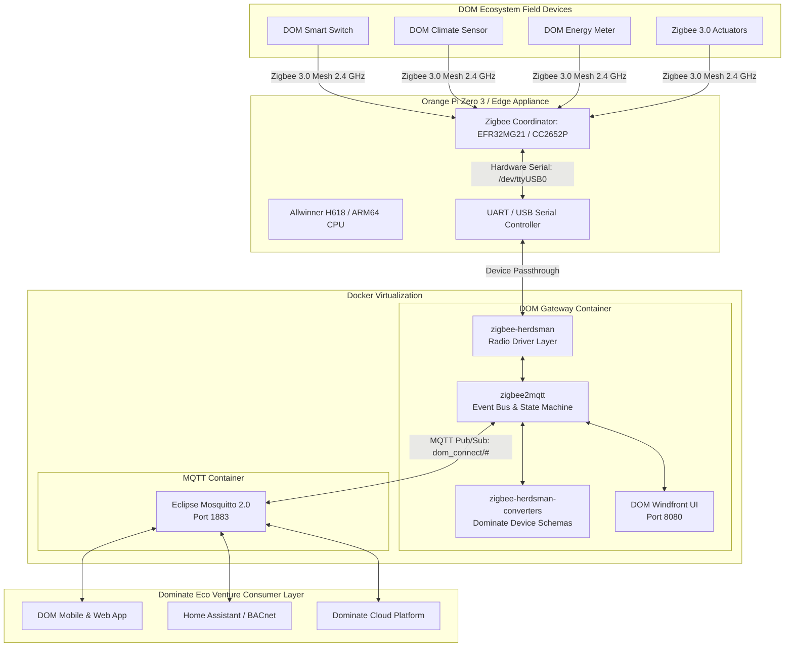
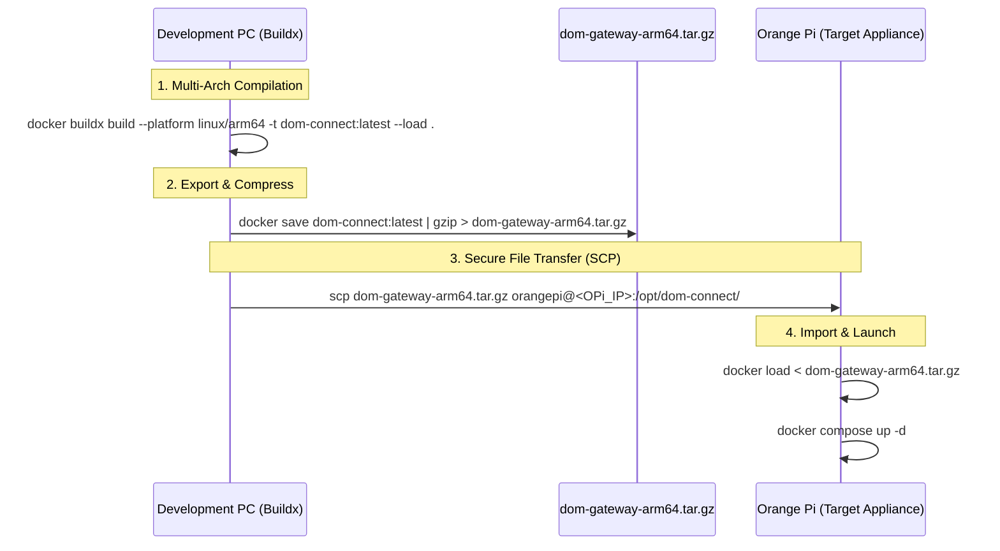

<div align="center">


# DOM ECOSYSTEM™
### DOM Connect™ Enterprise Zigbee Gateway Appliance
**Proprietary Edge Firmware & Operating Runtime by Dominate Eco Venture PVT LTD**  
*Optimized for Orange Pi (ARM64 / aarch64) Single-Board Edge Systems*

<br />

[](https://dominateecoventure.com)
[](LICENSE)
[-orange.svg?style=for-the-badge&logo=arm)](https://www.orangepi.org/)
[](docker-compose.yml)
[](https://csa-iot.org/)
[](zigbee2mqtt-windfront)
[]()

<br />

```
========================================================================================
   ____   ___  __  __   _____ ____ ___  ______   ______ _____ _____ __  __ 
  |  _ \ / _ \|  \/  | | ____/ ___/ _ \/ ___\ \ / / ___|_   _| ____|  \/  |
  | | | | | | | |\/| | |  _|| |  | | | \___ \\ V /\___ \ | | |  _| | |\/| |
  | |_| | |_| | |  | | | |__| |__| |_| |___) || |  ___) || | | |___| |  | |
  |____/ \___/|_|  |_| |_____\____\___/|____/ |_| |____/ |_| |_____|_|  |_|
              DOMINATE ECO VENTURE PVT LTD — DOM CONNECT GATEWAY
========================================================================================
```

</div>

---

> [!CAUTION]
> **PROPRIETARY AND CONFIDENTIAL — DOMINATE ECO VENTURE PVT LTD**  
> This software, documentation, and underlying hardware schematics contain strictly confidential and proprietary trade secrets belonging to **Dominate Eco Venture PVT LTD**. Unauthorized copying, reverse engineering, redistribution, commercial deployment, or modification of this codebase, via any medium, is strictly prohibited without prior express written consent from Dominate Eco Venture PVT LTD.

---

## 📑 Table of Contents

- [1. Executive Overview](#1-executive-overview)
- [2. Monorepo Architecture](#2-monorepo-architecture)
- [3. Hardware Specifications (Orange Pi)](#3-hardware-specifications-orange-pi)
- [4. Orange Pi System Preparation](#4-orange-pi-system-preparation)
- [5. Docker Deployment Workflows](#5-docker-deployment-workflows)
  - [Workflow A: Direct Build & Run on Orange Pi (Recommended)](#workflow-a-direct-build--run-on-orange-pi-recommended)
  - [Workflow B: Cross-Compilation on Workstation & Image Upload (Golden Image)](#workflow-b-cross-compilation-on-workstation--image-upload-golden-image)
  - [Workflow C: Private Container Registry (Enterprise CI/CD)](#workflow-c-private-container-registry-enterprise-cicd)
- [6. Configuration Guide](#6-configuration-guide)
- [7. Persistent Storage & Serial Port Passthrough](#7-persistent-storage--serial-port-passthrough)
- [8. Production Maintenance & Systemd Service](#8-production-maintenance--systemd-service)
- [9. Diagnostic & Troubleshooting Playbook](#9-diagnostic--troubleshooting-playbook)
- [10. Intellectual Property & Support](#10-intellectual-property--support)

---

## 1. Executive Overview

**DOM Connect™** is the flagship industrial-grade edge gateway firmware of the **DOM ECOSYSTEM™**, developed by **Dominate Eco Venture PVT LTD**. Engineered specifically for high-availability Internet of Things (IoT) deployments, commercial building automation, smart agriculture, and residential ecosystems.

Running on low-power, cost-effective **Orange Pi ARM64 single-board computers**, the gateway connects hundreds of Zigbee 3.0 sensors, relays, lighting modules, and energy monitors directly into the centralized Dominate Eco Venture Cloud and local management dashboards.

### Core Capabilities:
- **Comprehensive Hardware Abstraction**: Native support for Silicon Labs (EZSP/Ember) and Texas Instruments (Z-Stack) radio coordinators.
- **Integrated Monorepo Engine**: Full vertical integration of the communication stack (`zigbee-herdsman`), proprietary converter schemas (`zigbee-herdsman-converters`), and core MQTT engine (`zigbee2mqtt`).
- **DOM Windfront OS**: Proprietary, glassmorphic real-time administration dashboard with custom branding, optimized for mobile, tablet, and desktop diagnostics.
- **Containerized Edge Deployment**: Turn-key Docker & Docker Compose orchestration with automated health checks, minimal footprint, and zero-downtime recovery.
- **Local Autonomy**: Operates 100% offline without mandatory internet connectivity, retaining complete device state, bindings, and local automation rules.

---

## 2. Monorepo Architecture

The DOM Connect repository is structured as a high-performance **PNPM Workspace Monorepo**, ensuring atomic updates and strict dependency isolation:

```
DOM-CONNECT/
├── docs/images/dom_logo.png       # Dominate Eco Venture Dolphin Logo
├── docker-compose.yml             # Production Docker stack definition for Orange Pi
├── Dockerfile                     # Multi-stage ARM64/AMD64 hardened container image
├── package.json                   # Root monorepo workspace orchestration
├── pnpm-workspace.yaml            # Monorepo package registry
├── data/                          # Host persistent state mount
│   ├── gateway/                   # Configuration, state.json, coordinator backup
│   └── mosquitto/                 # Embedded MQTT broker database & logs
│
├── zigbee-herdsman/               # Hardware Abstraction Layer (HAL) for Zigbee radio SoC
├── zigbee-herdsman-converters/    # Dominate Eco Venture proprietary device definitions
├── zigbee2mqtt/                   # Core gateway event bus, routing engine & MQTT bridge
├── zigbee2mqtt-windfront/         # DOM Windfront branded real-time web interface
└── zigbee2mqtt-frontend/          # Fallback diagnostic web interface
```

### System Architecture Flow



---

## 3. Hardware Specifications (Orange Pi)

DOM Connect is fully certified and optimized for the **Orange Pi Zero 3**, while remaining compatible across the Orange Pi embedded family:

| Specification | Primary Target: Orange Pi Zero 3 | Compatible Alternates |
| :--- | :--- | :--- |
| **Processor** | Allwinner H618 Quad-core 64-bit Cortex-A53 @ 1.5 GHz | Orange Pi 3B / Orange Pi 5 (RK3588S) |
| **RAM** | 1GB / 2GB / 4GB LPDDR4 | 2GB+ recommended for 100+ devices |
| **Storage** | 16GB+ MicroSD (Class 10 A2) or eMMC | MicroSD / NVMe SSD |
| **Ethernet** | 1000M / 100M Gigabit RJ45 | Gigabit Ethernet |
| **Radio Coordinator**| Silicon Labs EFR32MG21 (USB / UART) | TI CC2652P / CC1352P-2 / ConBee III |
| **Serial Ports** | `/dev/ttyUSB0` (USB) or `/dev/ttyS1` (Header) | `/dev/ttyUSB0` / `/dev/ttyACM0` |
| **Power Input** | Type-C 5V / 3A Dedicated PSU | 5V / 3A - 4A Clean Power |
| **Operating System**| Armbian Linux (Bookworm/Jammy) 64-bit | Orange Pi OS (Debian/Arch) |

---

## 4. Orange Pi System Preparation

Before deploying the Docker stack, prepare your Orange Pi board with clean serial port access and required container runtimes.

### 4.1. Connect to Orange Pi via SSH
```bash
ssh orangepi@<ORANGE_PI_IP_ADDRESS>
```

### 4.2. Update OS & Install Prerequisites
```bash
sudo apt-get update && sudo apt-get upgrade -y
sudo apt-get install -y curl git udev htop ca-certificates gnupg
```

### 4.3. Install Docker Engine & Docker Compose
```bash
# Install Docker via official convenience script
curl -fsSL https://get.docker.com -o get-docker.sh
sudo sh get-docker.sh

# Add current user to docker and dialout groups
sudo usermod -aG docker $USER
sudo usermod -aG dialout $USER

# Install Docker Compose plugin
sudo apt-get install -y docker-compose-plugin

# Verify installation
docker --version
docker compose version
```
*(Log out and reconnect via SSH to apply user group memberships)*

### 4.4. Identify & Lock Serial Coordinator Port
Plug your Zigbee Coordinator into the USB port of the Orange Pi. Verify detection:
```bash
ls -l /dev/ttyUSB* /dev/ttyACM* 2>/dev/null
```

To prevent port shifting (e.g. `/dev/ttyUSB0` turning into `/dev/ttyUSB1` after a reboot), identify the unique device ID:
```bash
ls -l /dev/serial/by-id/
```

#### Create Persistent Udev Rule (Recommended for Production)
Create `/etc/udev/rules.d/99-dom-zigbee.rules`:
```bash
sudo tee /etc/udev/rules.d/99-dom-zigbee.rules << 'EOF'
SUBSYSTEM=="tty", ATTRS{idVendor}=="10c4", ATTRS{idProduct}=="ea60", SYMLINK+="dom-zigbee", MODE="0666", GROUP="dialout"
EOF
sudo udevadm control --reload-rules && sudo udevadm trigger
```
*Your coordinator will now permanently link to `/dev/dom-zigbee`.*

---

## 5. Docker Deployment Workflows

Dominate Eco Venture supports three standard workflows for deploying the firmware to an Orange Pi.

---

### Workflow A: Direct Build & Run on Orange Pi (Recommended)

Use this method when deploying directly to an Orange Pi connected to the network.

#### Step 1: Clone the Repository to the Orange Pi
```bash
cd /opt
sudo git clone https://github.com/Athul2004/DOM-CONNECT.git dom-connect
sudo chown -R $USER:$USER /opt/dom-connect
cd /opt/dom-connect
```

#### Step 2: Configure Environment & Persistent Data
```bash
# Ensure directories exist
mkdir -p data/gateway data/mosquitto/config data/mosquitto/data data/mosquitto/log

# Copy default configurations if not already created
cp data/gateway/configuration.example.yaml data/gateway/configuration.yaml
```

Inspect and verify your serial port in `data/gateway/configuration.yaml`:
```yaml
serial:
  port: /dev/ttyUSB0    # Or /dev/serial/by-id/... or /dev/dom-zigbee
  adapter: ember        # Use 'ember' for Silicon Labs EFR32MG21, 'zstack' for CC2652
```

#### Step 3: Build and Launch the Stack
```bash
# Build the images and start containers in detached mode
docker compose up -d --build
```

#### Step 4: Verify Deployment
```bash
# Monitor container status
docker compose ps

# Follow live gateway logs
docker compose logs -f dom-gateway
```

Access the **DOM Windfront Dashboard** at:
```
http://<ORANGE_PI_IP_ADDRESS>:8080
```

---

### Workflow B: Cross-Compilation on Workstation & Image Upload (Golden Image)

Use this method to generate a pre-built binary image on your development machine (x86_64 or Apple Silicon) and upload it directly to the Orange Pi without needing compilation on the board.



#### Step 1: Build for ARM64 on your PC
On your development machine (Linux, macOS, or Windows with Docker Desktop):
```bash
# Enable Docker Buildx multi-arch builder
docker buildx create --use --name dom-builder 2>/dev/null || docker buildx use dom-builder

# Compile specifically for ARM64 (Orange Pi target)
docker buildx build \
  --platform linux/arm64 \
  -t dom-ecosystem/dom-connect:latest \
  --load \
  .
```

#### Step 2: Export and Compress the Image Artifact
```bash
docker save dom-ecosystem/dom-connect:latest | gzip > dom-connect-arm64.tar.gz
```

#### Step 3: Transfer Artifact to Orange Pi
```bash
# Create target directory on Orange Pi
ssh orangepi@<ORANGE_PI_IP> "mkdir -p /opt/dom-connect"

# Secure copy image and orchestration files
scp dom-connect-arm64.tar.gz orangepi@<ORANGE_PI_IP>:/opt/dom-connect/
scp docker-compose.yml orangepi@<ORANGE_PI_IP>:/opt/dom-connect/
scp -r data orangepi@<ORANGE_PI_IP>:/opt/dom-connect/
```

#### Step 4: Load and Launch on Orange Pi
```bash
ssh orangepi@<ORANGE_PI_IP>
cd /opt/dom-connect

# Unpack and register the Docker image
gunzip -c dom-connect-arm64.tar.gz | docker load

# Start the stack using the pre-loaded image
docker compose up -d
```

---

### Workflow C: Private Container Registry (Enterprise CI/CD)

For automated industrial fleets and OTA firmware updates:

1. **Tag & Push to Corporate Registry:**
   ```bash
   docker tag dom-ecosystem/dom-connect:latest ghcr.io/athul2004/dom-connect:v1.0.0
   docker push ghcr.io/athul2004/dom-connect:v1.0.0
   ```

2. **On the Orange Pi:**
   Update `docker-compose.yml`:
   ```yaml
   dom-gateway:
     image: ghcr.io/athul2004/dom-connect:v1.0.0
   ```
   Deploy the update:
   ```bash
   docker compose pull
   docker compose up -d --remove-orphans
   ```

---

## 6. Configuration Guide

All configuration is maintained in [`data/gateway/configuration.yaml`](file:///c:/Users/athul/OneDrive/Documents/GitHub/DOM-CONNECT/data/gateway/configuration.example.yaml).

```yaml
# ==============================================================================
#  DOMINATE ECO VENTURE PVT LTD — GATEWAY APPLIANCE CONFIGURATION
# ==============================================================================

# Home Assistant MQTT Discovery integration
homeassistant:
  enabled: true

# MQTT Broker Connection
mqtt:
  base_topic: dom_connect
  server: mqtt://localhost:1883
  # user: dom_user
  # password: dom_secure_token

# Serial Zigbee Radio Configuration
serial:
  port: /dev/ttyUSB0
  adapter: ember        # 'ember' (Silicon Labs EFR32MG) or 'zstack' (TI CC2652)
  baudrate: 115200      # 115200 standard / 230400 for high-throughput firmware
  rtscts: false         # Enable hardware flow control if coordinator pins support it

# Web Diagnostics & DOM Windfront Management UI
frontend:
  port: 8080
  host: 0.0.0.0
  package: zigbee2mqtt-windfront

# Zigbee Network Parameters
advanced:
  log_level: info
  channel: 15           # Channels 15, 20, 25 are optimal for avoiding 2.4GHz Wi-Fi
  pan_id: 0x1a62
  ext_pan_id: [0xdd, 0xdd, 0xdd, 0xdd, 0xdd, 0xdd, 0xdd, 0xdd]
  network_key: GENERATE # Will auto-generate secure 128-bit AES key on first boot

# Real-Time Device Availability Ping
availability:
  active:
    timeout: 10
  passive:
    timeout: 1500
```

---

## 7. Persistent Storage & Serial Port Passthrough

To ensure seamless operation on embedded Linux:

### 1. Serial Passthrough in `docker-compose.yml`
```yaml
devices:
  - /dev/ttyUSB0:/dev/ttyUSB0
```
If using a persistent udev symlink:
```yaml
devices:
  - /dev/dom-zigbee:/dev/ttyUSB0
```

### 2. Persistent Volumes
The following directories on the host preserve critical runtime state:
- `./data/gateway/state.json`: Last-known power and sensor readings.
- `./data/gateway/database.db`: SQLite/JSON database containing paired IEEE addresses, endpoints, and encryption keys.
- `./data/gateway/coordinator_backup.json`: Automatic daily radio NVRAM backup. If hardware coordinator fails, a new coordinator can be plugged in without re-pairing any devices!
- `./data/mosquitto/data/`: Retained MQTT messages and QoS delivery logs.

---

## 8. Production Maintenance & Systemd Service

To ensure the DOM Gateway automatically launches on boot and recovers from unexpected power failures, install the systemd supervisor unit.

### 8.1. Create Systemd Service Unit
Create `/etc/systemd/system/dom-gateway.service`:
```ini
[Unit]
Description=DOM ECOSYSTEM - Connect Zigbee Gateway Appliance (Dominate Eco Venture)
Requires=docker.service
After=docker.service network-online.target
Wants=network-online.target

[Service]
Type=oneshot
RemainAfterExit=yes
WorkingDirectory=/opt/dom-connect
ExecStart=/usr/bin/docker compose up -d
ExecStop=/usr/bin/docker compose down
TimeoutStartSec=300

[Install]
WantedBy=multi-user.target
```

### 8.2. Enable & Start Service
```bash
sudo systemctl daemon-reload
sudo systemctl enable dom-gateway.service
sudo systemctl start dom-gateway.service
```

### 8.3. Useful Production Commands
```bash
# Check service status
sudo systemctl status dom-gateway.service

# View live gateway logs
docker compose -f /opt/dom-connect/docker-compose.yml logs -f --tail=100 dom-gateway

# Restart gateway stack
sudo systemctl restart dom-gateway.service

# Backup gateway database & configuration
tar -czvf dom-backup-$(date +%F).tar.gz /opt/dom-connect/data
```

---

## 9. Diagnostic & Troubleshooting Playbook

| Symptom | Probable Cause | Corrective Action |
| :--- | :--- | :--- |
| **`Error: Error Resource temporarily unavailable Cannot lock port`** | Another process (e.g. `brltty`, ModemManager, or serial console) has locked the port. | Run `sudo apt-get purge -y brltty modemmanager` and restart the Orange Pi. |
| **`Error: Failed to connect to coordinator`** | Wrong baudrate, incorrect adapter type, or port permissions. | Verify port in `configuration.yaml`. Try `adapter: ember` for Silicon Labs, or check `sudo dmesg \| grep tty`. |
| **Web UI inaccessible at port 8080** | Firewall or container network binding issue. | Verify with `sudo ufw allow 8080/tcp` and ensure `network_mode: host` is set in `docker-compose.yml`. |
| **Zigbee devices unable to join** | Permit Join is disabled or radio channel interference. | Click "Permit Join (All)" in DOM Windfront UI. Change channel to `15`, `20`, or `25` away from your Wi-Fi AP. |
| **Docker out of memory during direct build** | Compiling TypeScript on 1GB RAM Orange Pi without swap. | Add 2GB swap space: `sudo fallocate -l 2G /swapfile && sudo chmod 600 /swapfile && sudo mkswap /swapfile && sudo swapon /swapfile`. Alternatively, use **Workflow B** (Cross-build). |

---

## 10. Intellectual Property & Support

### Proprietary License Terms
Copyright © 2026 **Dominate Eco Venture PVT LTD**. All Rights Reserved.

- This software and associated documentation files are the proprietary property of **Dominate Eco Venture PVT LTD**.
- Commercial use, deployment in unauthorized third-party appliances, reverse engineering, decompilation, and unauthorized distribution are strictly prohibited under national and international intellectual property laws.

### Enterprise Engineering Support
For industrial hardware licensing, custom Zigbee cluster definitions, or white-label appliance deployments:

- **Corporate Portal**: [https://dominatee.com/](https://dominatee.com/)
- **Technical Inquiries**: `athuls.eng@gmail.com`
  

---

<div align="center">

<br />
<b>Dominate Eco Venture PVT LTD — Powering Intelligent, Resilient, Enterprise IoT Infrastructure.</b>
</div>
